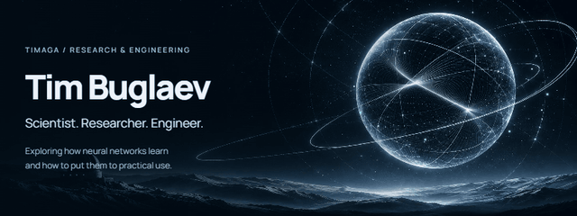
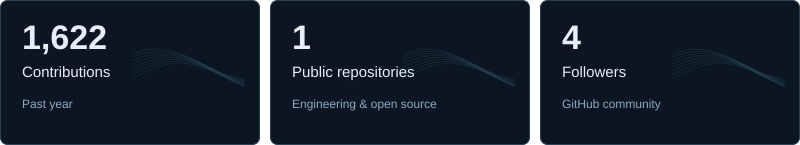

<a name="top"></a>

<p align="center">
  <picture>
    <source media="(prefers-reduced-motion: reduce)" srcset="assets/hero-static.jpg">
    <source type="image/webp" srcset="assets/hero.webp">
    
  </picture>
</p>

<p align="center">
  <a href="#research">Research</a> · <a href="#experiments">Experiments</a> · <a href="#toolkit">Toolkit</a>
</p>

<picture>
  <source media="(max-width: 600px) and (prefers-color-scheme: dark)" srcset="assets/stats-dark-mobile.svg">
  <source media="(max-width: 600px) and (prefers-color-scheme: light)" srcset="assets/stats-light-mobile.svg">
  <source media="(prefers-color-scheme: light)" srcset="assets/stats-light.svg">
  
</picture>

<p><sub>Public GitHub snapshot · 3 November 2026.</sub></p>

## Research

<p>I research methods for training neural networks and explore their practical applications.</p>

<details>
<summary><strong>Explore my research interests</strong></summary>

<ul>
  <li><strong>Training methods:</strong> exploring how neural networks learn and how their training can be improved.</li>
  <li><strong>Experiments:</strong> connecting ideas with implementations and observable results.</li>
  <li><strong>Practical applications:</strong> applying neural networks to useful, real-world tasks.</li>
</ul>

</details>

## Experiments

<p><strong>Learning representations.</strong></p>

<picture>
  <source media="(prefers-reduced-motion: reduce)" srcset="assets/latent-static.jpg">
  <source type="image/webp" srcset="assets/latent.webp">
  
</picture>

<p><sub>From tangled patterns to useful structure. An illustration of representation learning.</sub></p>

<details>
<summary><strong>What does this animation show?</strong></summary>

<p>Representation learning transforms raw inputs into features that make structure easier to work with. Here, two intertwined groups of points unfold into distinct ribbons.</p>

<p>This is a visual analogy: the motion is designed to illustrate the idea, rather than report a trained model's results.</p>

<details>
<summary>A simple mathematical view</summary>

```math
z=f_{\theta}(x)
```

<p>The input x is transformed by a neural network with parameters θ into a representation z.</p>

</details>
</details>

## Toolkit

<p>
  
  
  
  
  
</p>

<details>
<summary><strong>Explore language statistics</strong></summary>

<p>Primary language per public repository. Repository counts reflect GitHub's classification, rather than language proficiency or code volume.</p>

<table>
  <thead><tr><th>Primary language</th><th>Repositories</th></tr></thead>
  <tbody>
    <tr><td>C++</td><td>5</td></tr>
    <tr><td>CMake</td><td>2</td></tr>
    <tr><td>Dart</td><td>1</td></tr>
    <tr><td>Kotlin</td><td>1</td></tr>
    <tr><td>Python</td><td>1</td></tr>
    <tr><td>Not specified</td><td>3</td></tr>
  </tbody>
</table>

</details>

<hr>

<p align="center"><sub>Neural network training · Practical applications · Engineering</sub><br><a href="#top">Back to top ↑</a></p>
